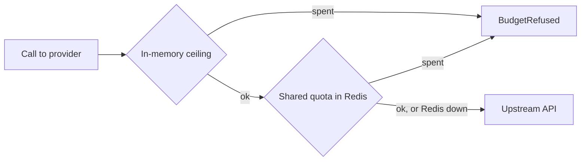

# fail-closed-budget

Budgets for **outbound** API calls, built so the one that matters most keeps working when Redis doesn't.

## The problem

A site that reads from third-party APIs usually has three things in front of them: a cache, a rate limiter for its own visitors, and Redis behind both.

When Redis goes down, the visitor rate limiter should fail **open**, because a store outage shouldn't lock readers out. The cache is gone too, though, so every page view is a cache miss and turns into upstream calls. On one page of the site this came from, a single cold render is 28 calls to a movie API. If the outbound limit also lived in Redis, it would vanish at exactly the moment it's needed. The site would burn through the provider's quota in minutes and get cut off.

So this package has two layers that fail in opposite directions on purpose:



| Layer | Where it counts | When the store is down |
|---|---|---|
| `createMemoryBudget` | Process memory | Keeps working. Fails **closed** once the window is spent. |
| `createSharedBudget` | Redis (or any store with `incr`, `expire`, `get`) | Fails **open**: allows the call. |

A refused call throws `BudgetRefused`. It never comes back as an empty list. If it did, the page would say "no results" when the truth is "we chose not to ask", and nobody could tell an outage from an empty day.

## Use

Clone the repo and import from `src/`:

```ts
import { createMemoryBudget, createSharedBudget, guarded, BudgetRefused } from './src/index.js';

const memory = createMemoryBudget({
  movies: { limit: 240, windowMs: 60_000 },
  scores: { limit: 20, windowMs: 60_000 },
});

const shared = createSharedBudget(redis, {
  movies: { limit: null, windowSeconds: 60 },   // no published limit: never throttled
  scores: { limit: 10, windowSeconds: 60 },
});

try {
  const table = await guarded('scores', () => fetchStandings(), { memory, shared });
} catch (e) {
  if (e instanceof BudgetRefused) {
    // Show "couldn't check just now", not "no matches today".
  }
}
```

`redis` is anything with `incr`, `expire` and `get`. Those method shapes match the Upstash Redis and ioredis clients. The tests use an in-memory fake, not a live Redis.

`shared.peek(provider)` reads what's left without spending it, so you can pick which source in a fallback chain to try first.

## Design choices

- **The in-memory ceiling is per process, on purpose.** It's the one limit a process can enforce without a store it can't rely on. Set it to your share of the provider quota divided by the number of instances, and the shared quota in Redis covers the account total whenever Redis is up.
- **A refused call is refused at once.** No queue, no retry, no waiting. The caller gets `BudgetRefused` straight away and can fall back to cached data or the next source in its chain, which is what a page render needs.
- **A provider missing from the config is unbounded.** A typo in a key leaves that provider unbounded rather than silently blocking every call to it.

## How it's tested

- **Example tests** for both layers and the guard, including the case the package exists for. With the store down and the shared quota failing open, 10 calls against a ceiling of 3 make exactly 3 upstream calls.
- **Property tests** (fast-check). For random limits, windows and call timings, every decision matches a small reference model of a fixed window, and the first call after an idle window is always allowed.
- **Mutation testing** (Stryker): it changes the code on purpose and checks that a test fails each time. CI fails below 90%. First CI run (16 Nov 2026): **100%**, 131 of 131 mutants killed ([run log](https://github.com/shad-yy/fail-closed-budget/actions/runs/43982498278)). Every later run prints its score in the run summary and attaches the HTML report as `mutation-report`.

```sh
npm ci
npm test
npm run typecheck
npm run mutation
```

Node 22 or later.

## Where it comes from

Sightline ([sightlinetv.com](https://sightlinetv.com)), a site that shows where a match, film or series can legally be watched in 139 markets. This is the outbound budget from its data layer, made generic. The full story of that system is in the [Sightline case study](https://github.com/shad-yy/sightline-case-study). Provider names, keys and URLs are taken out.

## Licence

MIT
